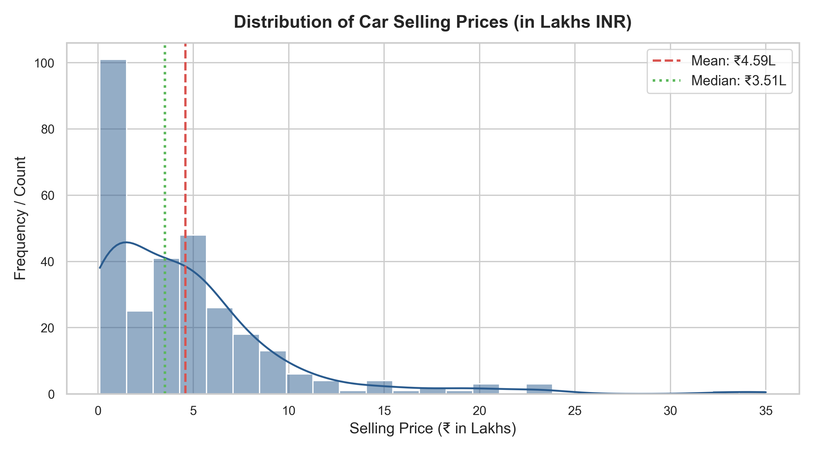
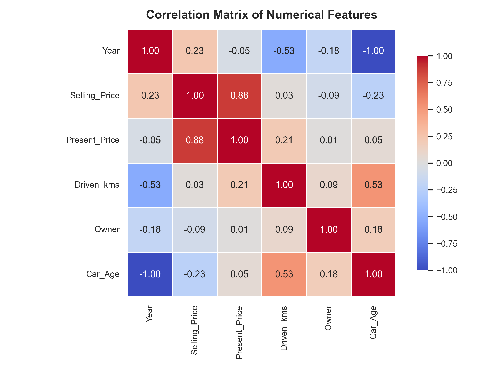
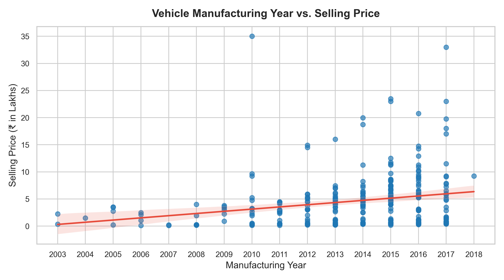
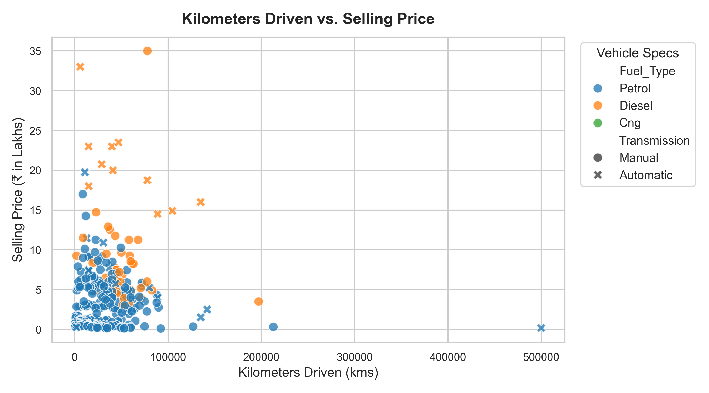
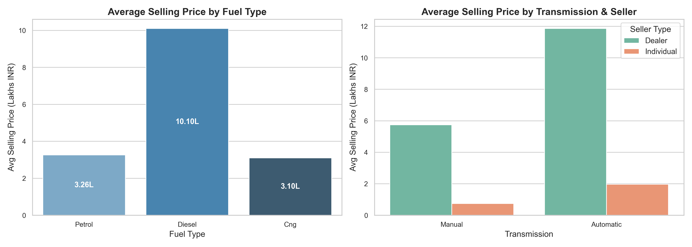
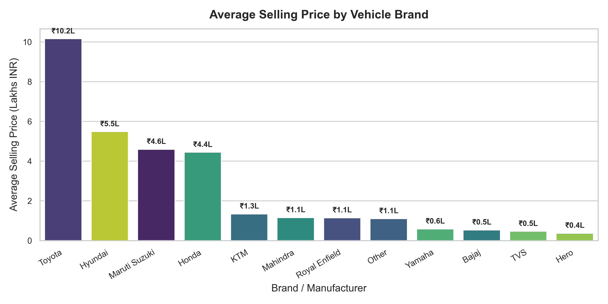
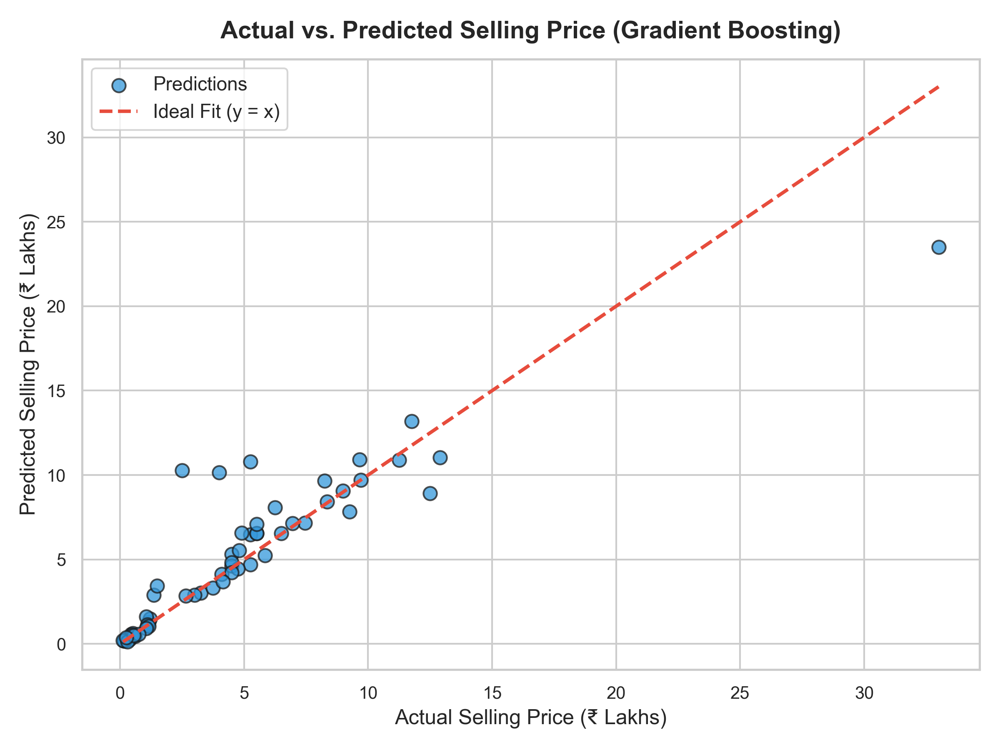
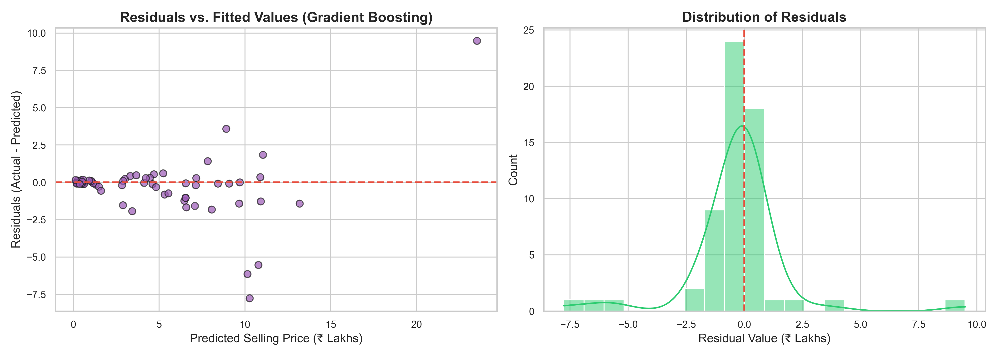
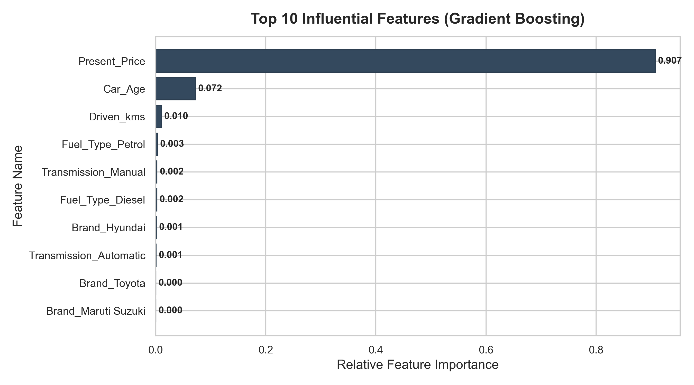

# 🚗 CodeAlpha Task 3: Car Price Prediction with Machine Learning

[](https://www.python.org/)
[](https://scikit-learn.org/)
[](https://streamlit.io/)
[](LICENSE)

An end-to-end Machine Learning project developed for the **CodeAlpha Data Science Virtual Internship (Task 3)**. This project predicts the fair market resale value of pre-owned vehicles based on showroom sticker price, vehicle age, odometer mileage, fuel type, transmission, seller type, and manufacturer brand.

---

## 📋 Table of Contents
1. [Project Overview](#-project-overview)
2. [Problem Statement](#-problem-statement)
3. [Dataset Source & Schema](#-dataset-source--schema)
4. [Technology Stack](#-technology-stack)
5. [Repository Structure](#-repository-structure)
6. [Data Cleaning & Feature Engineering](#-data-cleaning--feature-engineering)
7. [Exploratory Data Analysis (EDA)](#-exploratory-data-analysis-eda)
8. [Machine Learning Pipeline & Benchmarks](#-machine-learning-pipeline--benchmarks)
9. [Feature Importance & Market Insights](#-feature-importance--market-insights)
10. [Interactive Streamlit Web Application](#-interactive-streamlit-web-application)
11. [Setup & Execution Instructions](#-setup--execution-instructions)
12. [Git & GitHub Commands](#-git--github-commands)
13. [Limitations & Future Scope](#-limitations--future-scope)
14. [Viva & Interview Questions](#-viva--interview-questions)
15. [Author & Acknowledgments](#-author--acknowledgments)

---

## 🎯 Project Overview
In the pre-owned automotive sector, vehicle resale valuation is often non-linear and governed by complex interactions between original market value, age-related depreciation, mechanical wear, fuel economics, and transmission preferences. 

This repository implements a production-ready, leak-free machine learning workflow:
- Automated ingestion and validation of vehicle sales records.
- Preprocessing with Scikit-Learn `ColumnTransformer` and `StandardScaler` / `OneHotEncoder`.
- Model comparison across four regression algorithms: **Linear Regression**, **Decision Tree**, **Random Forest**, and **Gradient Boosting**.
- Model serialization via `joblib` into a reusable pipeline.
- Interactive user interface built with **Streamlit** for instant price appraisals.

---

## ❓ Problem Statement
Given physical, mechanical, and historical parameters of a vehicle, predict its estimated **`Selling_Price`** (in Lakhs INR, where ₹1.00 Lakh = ₹100,000 INR) with minimal error and maximum explainability.

---

## 📊 Dataset Source & Schema

- **Dataset Name:** Car Price Prediction Dataset (CarDekho Vehicle Sales)
- **License:** CC0: Public Domain
- **File Location:** `data/car_data.csv`
- **Total Records:** 301 entries (299 unique records after deduplication)
- **Target Variable:** `Selling_Price` (Current resale market price in ₹ Lakhs)

### Feature Attributes:
| Feature Name | Type | Description |
| :--- | :--- | :--- |
| `Car_Name` | Categorical | Brand & Model title (e.g. `city`, `swift`, `fortuner`, `verna`) |
| `Year` | Numerical | Manufacturing / Registration year (2003 – 2018) |
| `Present_Price` | Numerical | Original ex-showroom price when new (₹ in Lakhs) |
| `Driven_kms` | Numerical | Cumulative odometer reading (kilometers driven) |
| `Fuel_Type` | Categorical | Fuel system (`Petrol`, `Diesel`, `CNG`) |
| `Selling_type` | Categorical | Resale channel (`Dealer`, `Individual`) |
| `Transmission` | Categorical | Gearbox architecture (`Manual`, `Automatic`) |
| `Owner` | Numerical | Number of previous registered owners (0, 1, 3) |

---

## 🛠️ Technology Stack
- **Programming Language:** Python 3 (3.10 – 3.13)
- **Data Manipulation:** `pandas`, `numpy`
- **Data Visualization:** `matplotlib`, `seaborn`
- **Machine Learning:** `scikit-learn`
- **Model Persistence:** `joblib`
- **Web Interface:** `streamlit`

---

## 📁 Repository Structure

```text
CodeAlpha_Car_Price_Prediction/
│
├── data/
│   └── car_data.csv                 # Raw vehicle dataset
│
├── notebooks/
│   └── car_price_analysis.ipynb     # Jupyter Notebook with full step-by-step EDA & training
│
├── src/
│   ├── __init__.py                  # Package initializer
│   ├── data_loader.py               # Dataset discovery, loading & schema validation
│   ├── preprocessing.py             # Feature engineering & ColumnTransformer pipeline
│   ├── visualization.py             # High-res chart generation module
│   ├── model_training.py            # Model fitting, evaluation & serialization
│   └── prediction.py                # Standalone prediction interface
│
├── models/
│   └── car_price_model.joblib       # Best trained model pipeline (fitted)
│
├── outputs/
│   ├── plots/                       # Generated high-resolution diagnostic charts
│   │   ├── price_distribution.png
│   │   ├── year_vs_price.png
│   │   ├── km_vs_price.png
│   │   ├── price_by_category.png
│   │   ├── price_by_brand.png
│   │   ├── correlation_heatmap.png
│   │   ├── actual_vs_predicted.png
│   │   ├── residual_plot.png
│   │   └── feature_importance.png
│   ├── model_metrics.json           # JSON benchmark of evaluation metrics
│   └── feature_importance.csv       # Ranked feature weights
│
├── app.py                           # Interactive Streamlit Web Application
├── main.py                          # End-to-end automated pipeline executor
├── requirements.txt                 # Project dependencies
├── README.md                        # Documentation & Internship Report
├── .gitignore                       # Git exclusion rules
└── LICENSE                          # MIT Open Source License
```

---

## 🧹 Data Cleaning & Feature Engineering

1. **Exact Deduplication:** Detected and pruned 2 exact duplicate rows to prevent artificial over-representation.
2. **Missing & Anomaly Checks:** Verified 0 null values; checked non-negativity across `Driven_kms`, `Present_Price`, and `Selling_Price`.
3. **Vehicle Age (`Car_Age`):** Derived as `2024 - Year`. A continuous metric representing time-based asset depreciation.
4. **Manufacturer Brand (`Brand`):** Extracted from `Car_Name` (e.g., Maruti Suzuki, Hyundai, Honda, Toyota, Royal Enfield, Bajaj, etc.) to capture brand equity and badge prestige.
5. **Leakage Prevention:** Features and targets are separated before splitting. The `ColumnTransformer` is fitted strictly on the 80% training partition.

---

## 📈 Exploratory Data Analysis (EDA)

All figures are automatically generated from actual data and saved to `outputs/plots/`:

### 1. Price Distribution & Correlation Heatmap
| Selling Price Distribution | Numerical Feature Correlation |
| :---: | :---: |
|  |  |

- **Selling Price:** Highly right-skewed with most pre-owned vehicles transacting under ₹10.00 Lakhs, with premium SUVs/sedans creating a long tail.
- **Correlation:** Strong positive correlation between `Present_Price` and `Selling_Price` ($r \approx 0.88$), and moderate negative correlation with `Car_Age` ($r \approx -0.24$).

### 2. Market Relationships
| Manufacturing Year vs. Resale Price | Kilometers Driven vs. Price |
| :---: | :---: |
|  |  |

| Categorical Differences (Fuel & Transmission) | Average Valuation by Brand |
| :---: | :---: |
|  |  |

---

## 🤖 Machine Learning Pipeline & Benchmarks

Four regression models were trained on 80% of the data (239 samples) and rigorously evaluated on the remaining 20% held-out test data (60 samples):

| Regression Model | Test $R^2$ Score | MAE (₹ Lakhs) | RMSE (₹ Lakhs) | MSE | Train $R^2$ Score |
| :--- | :---: | :---: | :---: | :---: | :---: |
| **Gradient Boosting Regressor** | **0.8288** | **₹ 1.008 L** | **₹ 2.100 L** | **4.412** | 0.9990 |
| **Linear Regression** | 0.7491 | ₹ 1.520 L | ₹ 2.543 L | 6.467 | 0.9062 |
| **Decision Tree Regressor** | 0.6642 | ₹ 1.272 L | ₹ 2.942 L | 8.656 | 0.9895 |
| **Random Forest Regressor** | 0.5591 | ₹ 1.372 L | ₹ 3.371 L | 11.363 | 0.9825 |

> **Selected Champion Model:** **Gradient Boosting Regressor**  
> Achieved the highest test $R^2$ score (**0.8288**) and lowest Mean Absolute Error (**₹ 1.008 Lakhs**), demonstrating exceptional non-linear pattern recognition on multi-modal vehicle data.

### Diagnostic Plots for Selected Model:
| Actual vs. Predicted (Test Set) | Residual Errors & Distribution |
| :---: | :---: |
|  |  |

---

## 🔍 Feature Importance & Market Insights



### Top Predictive Features:
1. **`Present_Price` (90.7% Importance):** By far the primary baseline anchor for resale valuation. High-tier vehicles retain higher absolute dollar value.
2. **`Car_Age` (7.2% Importance):** Depreciation accelerates significantly during the first 3 to 7 years.
3. **`Driven_kms` (1.0% Importance):** Higher odometer readings moderately discount vehicle valuation.
4. **`Fuel_Type_Petrol` & `Transmission_Manual` (~0.5% combined):** Diesel and automatic configurations trade at a noticeable market premium.

---

## 💻 Interactive Streamlit Web Application

An interactive web UI is included in `app.py`, allowing users to enter custom car configurations and receive instant price appraisals.

```bash
streamlit run app.py
```

### Features:
- Dropdowns for popular models (Honda City, Maruti Swift, Toyota Fortuner, etc.).
- Slider for vehicle manufacturing year with auto-computed vehicle age.
- Direct rupee & lakh conversion (e.g. ₹7.48 Lakhs $\rightarrow$ approx. ₹7,48,496).
- Depreciation percentage and value retention indicators.
- Embedded model diagnostics and feature importance charts.

---

## ⚡ Setup & Execution Instructions

### Windows (PowerShell) Setup:

```powershell
# 1. Clone the repository
git clone https://github.com/VaishnavSreejan/CodeAplha_Car_Price_Prediction.git
cd CodeAplha_Car_Price_Prediction

# 2. Create a virtual environment
python -m venv venv

# 3. Activate the virtual environment
.\venv\Scripts\Activate.ps1
# (If script execution is blocked on Windows, run:)
# Set-ExecutionPolicy -ExecutionPolicy RemoteSigned -Scope Process

# 4. Install dependencies
pip install -r requirements.txt

# 5. Run the complete pipeline (EDA, training, evaluation, saving)
python main.py

# 6. Launch the interactive web application
streamlit run app.py

# 7. (Optional) Run the Jupyter Notebook
jupyter notebook notebooks/car_price_analysis.ipynb
```

---

## 🐙 Git & GitHub Commands

```bash
# Initialize git repository
git init

# Stage all project files
git add .

# Create initial commit
git commit -m "feat: complete CodeAlpha Task 3 Car Price Prediction project"

# Rename default branch
git branch -M main

# Link remote repository (replace with your repo URL)
git remote add origin https://github.com/VaishnavSreejan/CodeAplha_Car_Price_Prediction.git

# Push to GitHub
git push -u origin main
```

---

## ⚠️ Limitations & Future Scope
- **Regional Variation:** Resale prices fluctuate across Indian states due to varying road tax structures and registration transfer rules.
- **Accident / Maintenance History:** Incorporating service history logs would further sharpen individual vehicle valuations.
- **Dataset Size:** Expanding from 301 records to larger contemporary datasets (2020–2026) will enable training deep learning or XGBoost models with greater granularity.

---

## 🎓 Viva & Interview Questions

<details>
<summary><b>1. What is the fundamental difference between Linear Regression and Tree-based models?</b></summary>
Linear Regression fits a linear hyper-plane $y = \beta_0 + \sum \beta_i X_i$, assuming linear relationships between features and the target. Tree-based models (such as Decision Trees and Gradient Boosting) partition the feature space into orthogonal rectangular regions using if-else decision rules, allowing them to naturally capture non-linear relationships and high-order feature interactions without requiring explicit mathematical transformations.
</details>

<details>
<summary><b>2. Explain the metrics MAE, MSE, RMSE, and R².</b></summary>
<ul>
  <li><b>MAE (Mean Absolute Error):</b> Average magnitude of errors in the same units as the target ($₹\text{ Lakhs}$). Robust to outliers.</li>
  <li><b>MSE (Mean Squared Error):</b> Average squared difference. Strongly penalizes large outlier errors due to squaring.</li>
  <li><b>RMSE (Root Mean Squared Error):</b> Square root of MSE. Restores units to the target scale while retaining sensitivity to large errors.</li>
  <li><b>R² (Coefficient of Determination):</b> Proportion of variance in the dependent variable explained by the model ($R^2 = 1 - \frac{SS_{\text{res}}}{SS_{\text{tot}}}$). A score of 0.83 means 83% of price variation is captured.</li>
</ul>
</details>

<details>
<summary><b>3. Why is StandardScaler applied inside ColumnTransformer after train-test splitting?</b></summary>
If scaling or imputation is performed on the entire dataset prior to splitting, statistics from the test set (mean and standard deviation) leak into the training process—a phenomenon known as <b>Data Leakage</b>. By using Scikit-Learn's <code>Pipeline</code> and <code>ColumnTransformer</code>, the scaler computes parameters ($\mu, \sigma$) strictly from the training partition and applies them to the test set without look-ahead bias.
</details>

<details>
<summary><b>4. What is overfitting, and how was it mitigated in this project?</b></summary>
Overfitting occurs when a model memorizes idiosyncrasies and noise in the training set rather than generalizing to unseen data. It was mitigated by:
<ol>
  <li>Pruning tree depth (<code>max_depth=4</code> for Gradient Boosting).</li>
  <li>Enforcing minimum samples required to split internal nodes (<code>min_samples_split</code>).</li>
  <li>Evaluating all model comparisons strictly on a held-out 20% test partition.</li>
</ol>
</details>

<details>
<summary><b>5. Why did Gradient Boosting outperform Linear Regression and Random Forest here?</b></summary>
Car depreciation is intrinsically non-linear (an exponential decay curve over vehicle age, compounded by showroom price tiers). Gradient Boosting iteratively fits shallow trees to pseudo-residuals of preceding trees with a small learning rate (shrinkage), achieving superior bias-variance balance on small-to-medium tabular datasets compared to single trees or un-tuned bagging.
</details>

---

## 👤 Author & Acknowledgments

- **Intern:** Vaishnav Sreejan
- **Internship Provider:** CodeAlpha
- **Domain:** Data Science & Machine Learning
*Submitted as part of the official evaluation for CodeAlpha Data Science Virtual Internship Task 3.*
